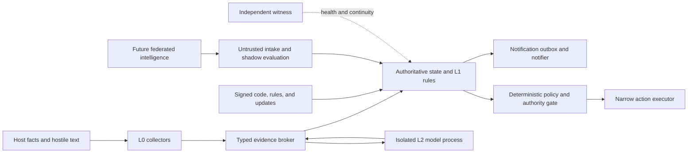

# Research: Antivirus and EDR Defensive Practice Applied to Descartes

## Executive Finding

Descartes is not an antivirus product, but it is growing into the same adversarial position. It
observes hostile machines, parses attacker-influenced data, keeps security-relevant history, holds
provider and notification credentials, and may later receive narrow authority to change a host. An
attacker will therefore try to exploit it, blind it, poison it, impersonate it, or turn its own
authority against the machine.

The useful antivirus/EDR inheritance is a set of engineering disciplines:

1. Separate the small privileged control plane from the large hostile-content plane.
2. Keep complex parsers and model-driven reasoning out of privileged processes.
3. Protect configuration, exclusions, update state, and health reporting as strongly as detection
   state.
4. Make loss of coverage, sensor silence, stale intelligence, and self-protection failure visible
   facts. Never translate them into healthy state.
5. Treat signed code as an identity claim, not proof that the code is safe. Minimize kernel code
   and maintain deny/recall paths for vulnerable components.
6. Secure updates against malicious artifacts, rollback, freeze, mix-and-match, and signing-key
   compromise; stage every high-impact rollout.
7. Test complete defensive outcomes under adversarial conditions, including parsing, detection,
   notification, recovery, tamper, resource exhaustion, and update failure.
8. Assume the model, learned baselines, federated intelligence, host logs, and tool output can all
   be adversarially influenced. None may grant authority by themselves.

The highest-value Descartes work is not an AV-style kernel sensor. It is a machine-readable attack
surface and capability register; confinement of the existing privileged helper; a protected local
service for authoritative state; isolation of the model and risky parsers; honest independent
health/coverage reporting; secure release and future-update metadata; and a permanent adversarial
validation program.

## Scope and Method

This research combines:

- the current Descartes code, tests, plans, and threat-model documents;
- historical failures in endpoint security products;
- current Microsoft, Apple, NIST, CISA, MITRE, TUF, SLSA, AMTSO, EICAR, and Google guidance;
- the preceding Descartes sandbox/microVM investigation;
- a final primary-source and source-code review, with the attempted independent review recorded in
  Review Provenance.

It focuses on architectural lessons and verification practices. It does not propose turning
Descartes into a malware scanner, installing a kernel driver, or copying the policy and fleet
assumptions of enterprise EDR products.

## Where Descartes Resembles Antivirus and EDR

The products share six structural properties:

1. **They consume attacker-controlled observations.** Filenames, process metadata, logs, service
   descriptions, container labels, archive contents, protocol replies, and command output can all
   be selected or influenced by an attacker.
2. **They need unusual visibility.** Cross-user process state, service state, sockets, audit logs,
   and future remediation often require authority beyond an ordinary application.
3. **They become a target once discovered.** Stopping the daemon, modifying exclusions, corrupting
   history, starving collectors, preventing updates, and spoofing a healthy UI all reduce defensive
   visibility.
4. **They have a dangerous update path.** Code, detection content, policies, and learned models can
   affect many hosts quickly and may execute or authorize privileged behavior.
5. **They can damage availability.** A defective collector, parser, rule, update, or containment
   action can consume resources, crash a host, block legitimate work, or lock out the operator.
6. **Their findings are probabilistic but their authority cannot be.** Heuristics, behavior models,
   and LLM synthesis are useful evidence. Authorization still requires deterministic policy and a
   freshly bound target.

Descartes also differs in ways that should shape the design:

- It is local-first and should not need continuous raw-telemetry export.
- Its current monitoring path is read-only/recommend-only; mutating containment is still design
  work.
- It reasons over host facts and operational behavior rather than scanning every arbitrary file.
- It has an explicit deliberative model layer, creating prompt-injection and evidence-confusion
  risks that traditional AV engines did not have.
- Its learning and possible federation layers create baseline-poisoning and distributed-trust
  problems beyond classic signature updates.

## Threat Model

### Attacker positions

Descartes should document claims separately for each attacker position:

| Position | Examples | Realistic assurance |
|---|---|---|
| Hostile observed data | Log lines, process arguments, labels, malformed command output, prompt instructions | Strict parsing, projection, bounds, provenance; no authority |
| Different unprivileged UID | Local malware or tenant process | Unix permissions, service identity, typed RPC, scoped collection |
| Same login UID | Malware running as the owner, stolen interactive session | Separate service UID and service-owned state; ordinary `0600` files are insufficient |
| Dedicated helper group member | A process intentionally admitted to the helper audience | Helper protocol and kernel enforcement must be safe even under direct invocation |
| Local administrator/root | Root malware, vulnerable-driver or kernel exploit | Host-local controls cannot guarantee integrity; external witness/attestation can reveal some compromise |
| Dependency/build/update attacker | Compromised package, CI worker, plugin, signing key, release account | Hermetic builds, provenance, thresholds/role separation, rollback/freeze protection, revocation |
| Model/provider/channel attacker | Prompt injection, provider compromise, stolen API key, malicious notification transport | Isolated L2 process, minimal projections, egress policy, deterministic authority boundary |
| Federated peer | Sybil, poisoned signature, replay, privacy probe | Signed bounded content, local shadowing, corroboration, reputation, recall, no raw telemetry by default |

### Attacker goals

Endpoint-security history suggests eight useful top-level attack goals:

- **Exploit:** obtain code execution through a parser, helper, driver, update, RPC, or extension.
- **Blind:** stop collectors, create telemetry gaps, exhaust limits, block logs, or force incomplete
  collection.
- **Mute:** disable notification, change routing, acknowledge or recover incidents falsely, or
  prevent delivery retries.
- **Poison:** make malicious behavior become baseline, inject false facts, corrupt history, or
  distribute a malicious signature/model.
- **Impersonate:** spoof Descartes output, a helper response, a release, an operator approval, or a
  peer.
- **Co-opt:** use Descartes' own helper, credentials, network, or future action executor against the
  host.
- **Exfiltrate:** make sensitive host data cross the model-provider, notification, artifact, or
  federation boundary.
- **Destabilize:** trigger loops, resource exhaustion, crash/restart storms, unsafe quarantine, or
  self-lockout.

### Assets and invariants

The assets are broader than files and credentials:

- truthful observation identity and provenance;
- declared coverage, completeness, freshness, and liveness;
- incident/history continuity;
- configuration, exclusions, policy, and authority state;
- executable and rule/update identity;
- provider, notifier, signing, and future action credentials;
- operator-visible status and audit receipts;
- availability of the monitored host and of Descartes;
- privacy of local evidence.

Four invariants should govern all future work:

1. Missing evidence never proves health or recovery.
2. An untrusted subject cannot enlarge its own capabilities or make its output authoritative.
3. Detection confidence cannot grant action authority.
4. A local root compromise exceeds the promise of host-local evidence unless an independent
   witness exists.

## Lessons From Endpoint-Security Failures and Defenses

### 1. The content parser is an exposed service even without a network socket

Google Project Zero's Symantec research found remotely triggerable vulnerabilities in unpackers,
document parsers, and emulators that ran as root or in the kernel. A file arriving by email or web
traffic could be scanned before the user opened it. The same engine was reused across product lines,
amplifying impact, and old embedded decompression libraries had missed years of security fixes.

For Descartes, every automatic parser is remotely or locally attacker reachable through the thing
it observes. This includes parsers for `ps`, `ss`, `journalctl`, launchd/systemd, container runtimes,
certificates, notification replies, helper JSON, model tool calls, config files, and future rule or
federation bundles. A fixed local command is not a trusted data source merely because the binary is
trusted.

Application:

- Parse the minimum representation needed and cap bytes, records, nesting, recursion, runtime, and
  allocation before semantic work.
- Keep complex parsing outside privileged processes.
- Preserve raw input only when necessary, under sensitivity and retention limits; give the model a
  bounded projection.
- Track each embedded parser/decompressor and its upstream version. Avoid private forks unless
  security fixes can be continuously merged.
- Fuzz boundary parsers continuously and retain every crash/hang input as a regression seed.
- A parser failure produces `unknown`, `partial`, or `unable`; it cannot become an empty healthy
  census.

### 2. Split privileged coordination from hostile-content processing

Microsoft Defender's sandbox design separates components that need broad system authority from the
content process that handles the highest-risk inputs. The content process runs with low privilege,
disables unnecessary system-call and extensibility surfaces, and loads only trusted code. The
privileged/sandbox bridge is kept small; Microsoft explicitly notes that simply passing handles can
grant excessive authority.

Application:

- Keep a small trusted broker responsible for target acquisition, policy, secrets, and result
  acceptance.
- Send immutable byte snapshots or narrow read requests to a parser worker. Do not hand it broad
  directory descriptors, runtime sockets, SSH agents, or state access.
- Treat the returned parse tree as untrusted until schema, budget, source identity, and requested
  scope are checked.
- Use separate profiles for process, log, network, and runtime collectors instead of one universal
  sandbox that necessarily sees everything.
- Isolate L2/model reasoning in an unprivileged process with only the typed evidence broker.

The preceding sandbox research recommends process isolation first, WASM for reviewed executable
extensions only when needed, and a microVM only for genuinely hostile native code.

### 3. Self-protection is a protected control plane, not obscurity

Malware routinely stops security services, changes config, adds exclusions, prevents updates,
deletes history, and spoofs a healthy UI. Microsoft Defender tamper protection therefore covers
service state, behavior monitoring, security-intelligence updates, automatic actions,
notifications, archive scanning, exclusions, and registry settings. Windows protected services add
OS code-integrity and anti-injection enforcement around an antimalware service.

Descartes should protect these as one control plane:

- daemon/service lifecycle;
- collector and protection-contract configuration;
- exclusions, suppressions, acknowledgments, recovery decisions, maintenance mode, and kill
  switches;
- detector/rule/model versions and promotion state;
- evidence/history continuity;
- notification routing and outbox state;
- helper/executor admission and capability manifests;
- update roots and minimum accepted versions;
- displayed health and coverage.

Configuration changes must return an explicit success or denial. A tool that silently makes a
change appear successful while blocking it creates an operator-trust defect. Maintenance and
break-glass changes should be time-limited, actor-bound, reasoned, audited, and automatically
restored.

The current same-UID state directories cannot provide this assurance. Protected mode needs the
already-designed separate service UID, service-owned state, root-owned code/config, and closed
typed RPC. A separate watchdog or witness must compare claimed health with real process, service,
and heartbeat state so a compromised UI cannot report green alone.

### 4. Minimize the kernel and privileged mechanism

Endpoint agents historically used drivers for filesystem interception, process callbacks, and
self-protection. Drivers also became local privilege-escalation and bring-your-own-vulnerable-driver
targets. Microsoft's driver guidance begins by asking whether a driver is needed at all, recommends
strict per-interface access control and threat modeling, and maintains a revocable vulnerable-driver
blocklist. Apple now recommends Endpoint Security, DriverKit, NetworkExtension, and system
extensions instead of kernel extensions because kexts risk OS integrity and reliability.

Application:

- Do not build a Descartes kernel module, filesystem filter, or custom hypervisor.
- Prefer stable OS telemetry and service interfaces, then a small user-mode service, then a narrow
  existing platform mechanism. Kernel code is a last resort with an explicit measured gap.
- Keep privileged Rust components free of `unsafe` and general plugin/FFI loading where feasible.
- Remove ambient capability sets; grant only per-operation authority and make direct invocation
  part of the threat model.
- Treat signing as identity and revocability, not safety. Maintain a minimum-safe-version and
  emergency deny/recall mechanism for helpers and extensions.

The current root helper is appropriately small and fixed-grammar, but the prior sandbox review
found that its allowed `openat/read/write/lseek` syscalls do not confine the full
`CAP_SYS_PTRACE,CAP_DAC_READ_SEARCH` blast radius. That must be corrected or the assurance claim
must be narrowed before the helper grows.

### 5. The update and intelligence channel is part of the authority plane

AV definitions update frequently, so the industry learned to sign content and distribute it
quickly. Signature verification alone does not address rollback, freeze, mix-and-match,
compromised signing keys, or a bad but legitimately signed release. TUF addresses metadata roles,
threshold signatures, version continuity, expiration, consistent snapshots, and explicit rollback
and freeze detection. SLSA provenance records where, when, and how an artifact was built. CISA's
safe-deployment guidance emphasizes canaries, controlled rollouts, monitoring, and feedback.

Application to code, rules, models, playbooks, and federated signatures:

- Pin an offline root of update trust; separate root, release/targets, snapshot, and online
  timestamp duties when automatic updates become real.
- Verify content digest, artifact type, target platform, schema, version, expiration, and minimum
  safe version before installation.
- Generate and verify build provenance, SBOMs, signatures/notarization, and exact-source-commit
  identity.
- Keep key rotation, compromise recovery, revocation, emergency freeze, and signature/rule recall
  runbooks.
- Roll out through lab, shadow, canary, limited cohort, and broad stages with automatic stop
  criteria. Never apply new action authority fleet-wide at once.
- Separate compatibility rollback from security downgrade. Recovery may return to a known-good
  version, but never below a revoked/minimum-safe version without an explicit break-glass process.
- Keep last-known-good code and rule sets, but record staleness and refuse authority whose required
  intelligence is expired.

Descartes already signs/notarizes the macOS notifier and publishes checksums. Before an automatic
agent/rule update path exists, it still needs the tracked exact-commit release gate, broader
artifact provenance, pinned toolchain/download verification, rollback/freeze semantics, and
staged/recall design.

### 6. Reliability failures are security failures

Endpoint software runs in critical paths. A bad update or parser can crash hosts, consume all CPU,
create I/O storms, or continuously restart. CISA treats controlled rollout, comprehensive testing,
feedback, and recovery as customer-safety requirements. Google recommends continuous fuzzing for
untrusted and complex inputs and explicitly includes hangs, memory exhaustion, recursion, races,
and logical discrepancies as fuzz targets.

Application:

- Give every collector/parser/model/backend a CPU, wall-time, memory, output, process-count, and
  concurrency budget.
- Use circuit breakers and exponential backoff. Persist enough state that a crash loop cannot erase
  the reason it was tripped.
- Ensure Descartes cannot fill the disk with facts, model transcripts, crash inputs, quarantined
  material, or audit records.
- Isolate optional work from the observation schedule. A slow model or notifier must not delay the
  next collection tick.
- Define host-safety budgets for future actions, including cumulative and fleet-wide effects.
- Test restart, partial write, full disk, read-only filesystem, clock shift, suspended laptop,
  network partition, dependency hang, and worker crash.

### 7. Behavior and signatures complement each other

Signatures cheaply recognize known bad patterns, while behavioral detection finds abuse through a
trusted or novel binary. Allowlisting limits execution but cannot alone defeat a compromised
allowed dependency. The durable endpoint pattern is layered: deterministic signatures, behavior
rules, baselines, exploit mitigation, and human investigation.

That matches Descartes' intended stratification. L0 facts and L1 rules should handle known cases;
statistical baselines should surface change; L2 should correlate novelty and ambiguity. Confirmed
findings should compile down into cheaper signatures and tests. The model should never replace
factual collection or deterministic policy.

### 8. Learning creates an attacker-controlled training channel

NIST's adversarial-ML taxonomy covers evasion, poisoning, privacy, and misuse attacks, including
generative-AI prompt injection. Descartes' learned baselines and future federation make these
concrete rather than theoretical:

- slow malicious behavior can become the baseline;
- an attacker can produce benign-looking evidence during the learning window;
- logs and process arguments can carry indirect prompt instructions;
- a peer can distribute poisoned signatures or outcomes;
- model/provider compromise can produce persuasive but unauthorized plans;
- stored cases can leak sensitive host data.

Application:

- Never learn from a period whose coverage or integrity is degraded.
- Bind every training/baseline point to collector version, coverage, boot/time identity, and source
  provenance.
- Keep positive historical incidents append-only; current configuration cannot reinterpret them
  away.
- Use shadow evaluation, holdouts, time-separated validation, rate-limited promotion, decay, and
  rollback. Measure false negatives as well as alert volume.
- Require corroboration across genuinely independent evidence paths rather than two transformations
  of one compromised sensor.
- Strip or clearly delimit instructions in evidence presented to the model; tool output is data,
  never policy.
- Treat model output as an untrusted proposal with citations. Deterministic code decides what data
  crosses boundaries and what action is authorized.

## A Descartes Attack-Surface Method

OWASP attack-surface analysis and Microsoft's driver threat-model guidance converge on a practical
method: enumerate every entry/exit point, data store, channel, privileged operation, and trust
boundary; follow the data; apply threat categories at each crossing; update the model whenever the
surface changes. Descartes should make this a maintained engineering artifact rather than an
occasional diagram.

### 1. Model flows and trust zones

The current and intended flow is approximately:



Every arrow is an attack surface. A process box is not automatically a trust boundary if both
processes share a writable UID, ambient credentials, or broad inherited descriptors.

### 2. Maintain a machine-readable surface register

Create one versioned registry entry for each collector, parser, model tool, RPC method, store,
notifier, helper verb, extension host function, update role, and future action. Recommended fields:

```json
{
  "id": "observe.socket_owner.v1",
  "implementation": "descartes-root-helper@sha256:...",
  "entry_sources": ["broker_rpc"],
  "input_schema": "socket-target.v1",
  "effect": "observe",
  "target_scope": ["socket"],
  "trust_zone": "privileged_observer",
  "os_authority": ["CAP_DAC_READ_SEARCH"],
  "state_reads": [],
  "state_writes": [],
  "network": "none",
  "secrets": "none",
  "output_sensitivity": "process_metadata",
  "budgets": {"deadline_ms": 3000, "output_bytes": 8192},
  "failure_semantics": "unknown_missing_permission",
  "identity_binding": ["boot_id", "protocol", "address", "port", "socket_inode"],
  "audit": "request_and_result_digest",
  "tests": ["direct_invocation", "race", "real_grant_escape", "malformed_output"],
  "owner": "root-helper",
  "last_reviewed": "2026-09-26"
}
```

The registry should generate or validate the model-visible tool list, broker policy, audit schema,
service sandbox profiles, documentation, and tests. A descriptive string such as `read_only` must
never be the sole authorization property. Protect the registry as policy: an untrusted component
must not be able to reduce its own declared authority, and policy revisions need authenticated,
anti-rollback versioning.

The registry describes intended authority. A protected service should also attest the observed
deployment and reconcile running processes, listeners, executable digests, UIDs/groups,
capabilities, open privileged endpoints, loaded extensions, and policy version against it. Drift
must become an explicit incident or `unknown`, not a documentation mismatch. This prevents a clean
manifest from concealing an unexpected runtime surface.

### 3. Track attack-surface changes in CI

A change should require a security review when it adds or widens any of these:

- a new input format or parser dependency;
- a network endpoint or outbound destination;
- an external command, executable path, or environment variable;
- filesystem read/write scope;
- state or credential access;
- a capability, UID transition, service group, system extension, or kernel interface;
- a model tool, RPC method, extension host function, or action verb;
- an exclusion, suppression, maintenance, update, or recovery path;
- a new data-egress route;
- a diagnostic, support-bundle, crash-dump, quarantine, or forensic-export path;
- a larger deadline, output, allocation, entity, recursion, or concurrency budget.

CI can compare the canonical registry to the base revision and emit a human-readable surface diff.
Unknown runtime capabilities or undocumented entry points should fail the relevant security gate.

### 4. Prioritize by reachable consequence

Raw counts of ports or APIs are a poor risk metric. Score each surface using:

- attacker reachability: remote, observed-host, same UID, group member, admin, supply chain;
- parsing complexity and implementation safety;
- privilege and assets reachable after compromise;
- persistence and fleet propagation;
- ability to suppress or forge audit;
- detection and recovery time;
- operational blast radius and reversibility.

A tiny unauthenticated method that changes exclusions is more important than a large read-only
status API. A parser in a capability-bearing process is more important than the same parser in a
disposable worker. A signed rule that propagates fleet-wide can outrank an unsigned local cache.

### 5. Model abuse cases, not only component bugs

For every sensitive operation, walk the full sequence and ask:

- Can a caller skip, replay, reorder, or race steps?
- Can observation and execution refer to different target identities?
- Can a successful validation be followed by mutable input or path substitution?
- Can maintenance, uninstall, update, or recovery become an authority bypass?
- Can the subject approve itself, select its backend, or create its own evidence?
- Can a failure be misreported as empty, healthy, recovered, delivered, or authorized?
- Can a legitimate signed component be obsolete, vulnerable, or maliciously configured?

This catches the semantic failures that STRIDE alone often leaves too abstract.

## Current Descartes Surface: Strengths and Gaps

### Strong foundations to preserve

- The model has an exact closed tool-name list and no shell/read/write/edit tools.
- Collectors use fixed argument arrays, bounded time/output, typed evidence envelopes, and explicit
  `partial`/`unable` degradation in many paths.
- The root helper is small Rust, has an exact command grammar, applies `NO_NEW_PRIVS` and seccomp,
  drops capabilities before output, and pins `/proc/<pid>` identity with directory descriptors.
- Security detectors increasingly distinguish evaluation coverage from an empty result, preventing
  missing work from fabricating recovery.
- Fact continuity, corrupt data, future timestamps, canary evidence, and degraded reads are already
  treated as security-significant.
- Model-authored behavior is declarative and evaluated through a bounded IR rather than arbitrary
  executable code.
- The future authority design keeps the model at proposal level and requires deterministic policy,
  off-machine single-use capability tokens, fresh target resolution, receipts, and rollback notes.
- The macOS notifier release is signed, notarized, stapled, verified, and checksummed.
- The current suite has 82 Node test files plus three root-helper integration-test files and Rust
  module tests, including substantial fail-closed and no-fabricated-recovery coverage.

### Highest-value current gaps

1. **No canonical attack-surface/capability registry.** Tool names, descriptions, command runners,
   state access, and privilege claims are spread across code and plans. Drift already exists: the
   `inspect_runtime_provenance` description says unprivileged-only although the executor can use
   the configured helper.
2. **Privileged-helper confinement is weaker than the claim.** The real capability union plus
   allowed file syscalls creates a broader read surface than its intended procfs protocol. The
   helper also has target-identity, mechanism-normalization, exit-code, and path check/use issues
   documented in the sandbox research.
3. **Authoritative state is still same-UID.** A same-login-UID attacker can change config, learned
   state, notification routing, or local integrity metadata. Hashes stored beside the data detect
   accidents but do not authenticate against that attacker.
4. **The model and most collectors share the main Node process and ambient context.** A defect in a
   parser, dependency, or agent runtime can reach state and credentials beyond its semantic task.
5. **Subprocess policy is decentralized.** Ordinary collectors commonly inherit ambient
   environment and resolve short command names through `PATH`; the privileged helper is stricter.
6. **Health is mostly self-reported.** The system needs a separately sourced comparison between
   declared health/coverage and real process, service, heartbeat, update, and delivery state.
7. **Evidence references are not immutable call identities.** Reusable envelope IDs can be
   overwritten inside the session registry, so later derivation may bind to a newer observation.
8. **Release integrity is incomplete for an endpoint-security role.** The exact-commit/x86_64 gate
   is tracked but unfinished. CI downloads the pinned Node version over TLS without independently
   checking the published digest, and no general SLSA/TUF-style provenance/update system exists.
9. **There is no continuous parser fuzzing or product-level defensive conformance suite.** Tests are
   strong around known contracts, but a permanent hostile-input and end-to-end impairment program
   is still missing.
10. **Declared policy is not reconciled with the running deployment.** There is no protected
    desired-versus-observed inventory for process identity, binary digest, UID/capabilities,
    listeners, extension set, or policy version. A future registry would remain advisory until
    this comparison exists.

The detailed helper and sandbox findings remain in
`docs/research/2026-09-26-sandbox-and-microvm-boundaries-research.md` and should not be duplicated
into separate, inconsistent fixes.

## Recommended Controls by Time Horizon

### Now: maintain the surface and close misleading claims

These can begin without enabling any new authority:

1. **Create the attack-surface registry and trust-flow diagrams.** Seed it from the current model
   tools, collector subprocesses, stores, notifier, auth/provider channels, root helper, release
   jobs, and config switches. Add a CI surface-diff report. Keep the initial artifact source-owned;
   later reconcile it with a protected runtime inventory instead of treating declarations as
   proof.
2. **Finish the active recovery-coverage milestone first.** It directly implements an EDR-grade
   invariant: a detector that did not evaluate a subject cannot clear its incident.
3. **Repair or narrow the root-helper boundary before expansion.** Add real-capability escape tests;
   bind full socket/process identity; make invalid mechanisms inert; separate exit codes; bind PID
   response scope; and eliminate path check/use ambiguity. Re-evaluate whether the same observation
   can be obtained with a narrower OS mechanism.
4. **Centralize local command execution.** Use platform-pinned executable identities, a minimal
   environment, fixed argv, per-command capability descriptors, deadlines, byte/entity limits,
   encoding/control-character policy, and uniform audit output.
5. **Make evidence IDs immutable.** Use a tool-call identity plus evidence/content digest; reject
   collisions; make every finding cite the exact observation version.
6. **Inventory tamper-sensitive controls.** Explicitly list every file/RPC that can disable
   observation, add exclusions, alter baselines, change notification, mark recovery, change helper
   admission, or select update/extension backends. Surface changes as security events.
7. **Define honest health.** Expose collector coverage, age, integrity, queue/delivery state,
   detector version, update age, sandbox/protected-mode state, and last successful self-test.
   `healthy` must require positive evidence rather than absence of errors.
8. **Add a safe product sentinel.** An EICAR-like Descartes test should inject harmless synthetic
   facts through the real pipeline and confirm observation, persistence, detection, notification,
   audit, and recovery. It must never require live malware.
9. **Protect diagnostic and recovery artifacts.** Redact secrets and hostile control text from logs
   and support bundles; disable or tightly control core dumps for credential-bearing processes;
   give crash inputs, quarantine objects, and forensic exports explicit ownership, retention,
   size, access, and egress policy.

### Near term: protected local mode and hostile-content isolation

1. **Build the separate-service-UID state boundary already described in the threat model.** The
   service constructs authoritative records through narrow RPCs; the login-UID CLI cannot append
   arbitrary facts or decisions.
2. **Move L2/model execution into an unprivileged process.** Give it evidence projections and one
   typed broker. Keep state, notifier/provider credentials, home directories, sockets, privileged
   helpers, and general network egress outside.
3. **Move high-risk parsers into disposable workers.** Start with complex or rapidly evolving
   runtime/log formats. Workers have capability-specific filesystem/network profiles and no state
   writes.
4. **Add self-health correlation.** A service watchdog and, when available, a second local or remote
   witness compare heartbeats, process/service identity, binary digest, coverage, update age, and
   notification delivery. It also reconciles the declared surface and policy version with the
   deployed service. Conflicts become incidents, not averaged confidence.
5. **Harden release production.** Complete exact-commit and supported-platform gates, verify
   toolchain downloads, pin CI plugins/images by immutable identity, publish SBOM and SLSA
   provenance, exercise signing-key rotation/revocation, and retain reproducible release evidence.
6. **Begin continuous fuzzing.** Good initial targets are evidence/config JSON, helper protocol,
   proc/socket parsers, collector command output, fact translators, model IR, alert transitions,
   notification encoding, and archive/artifact manifests. Include hang and allocation oracles, not
   only crashes.

### Before any mutating action

1. Implement the deterministic action-to-mechanism matrix and narrow per-verb executor from the
   existing authority design.
2. Require an off-machine, short-TTL, single-use capability token bound to verb, target identity,
   constraints, and request digest.
3. Capture pre-state and a write-ahead intent/nonce consumption record before mutation; capture
   result and post-state afterward.
4. Re-resolve target identity at execution time and reject replacement, ambiguity, or lost
   coverage.
5. Apply per-host and fleet-wide circuit breakers, concurrency/cumulative-effect budgets,
   automatic expiry, and operator-visible rollback.
6. Exercise actions first in dedicated Vault-Tec VMs, then shadow/prepare mode, then a tiny canary
   cohort. A clean rehearsal proves only mechanical compatibility.
7. Design quarantine as a distinct hostile-content boundary: content-addressed storage, no execute
   permission, symlink/race-safe moves, separate ownership, bounded size, explicit restore, and no
   privileged parsing inside the vault.

### When executable extensions become necessary

1. Preserve declarative rules as the default.
2. Use WASM for pure parsers/transforms over supplied snapshots, with no ambient filesystem,
   network, process, clock, or randomness capability; add fuel, memory, deadline, and output limits.
3. Content-address and sign extension modules; bind results to module digest and host-ABI version.
4. Run new modules against offline fixtures and shadow traffic before allowing detector output.
5. Use an ephemeral microVM only when a concrete native-code workload cannot fit WASM. Jail the VMM
   and enumerate every mount, socket, credential, and network bridge in the same surface registry.

### Before federation or fleet-wide intelligence

1. Share bounded signatures, playbooks, outcome summaries, and versioned schemas; do not default to
   raw logs, usernames, hostnames, paths, IPs, or stable host identifiers.
2. Authenticate publisher and artifact, but keep new content untrusted. Signature verifies origin,
   not truth.
3. Require local shadow evaluation, minimum evidence quality, expiry, scope, staged promotion, and
   fast recall/revocation.
4. Add Sybil resistance, publisher diversity, conflict reporting, rate limits, and a fleet-wide
   circuit breaker. Corroboration must not be countable self-agreement.
5. Separate detection-content distribution from action authorization. Federated intelligence may
   suggest or raise urgency; it cannot mint local execution authority.
6. Maintain privacy threat models for joins and repeated releases, not only individual fields.

## Platform Direction

### Linux

Use a separate system service identity, service-owned state, root-owned immutable deployment
material, Unix peer credentials on a closed local socket, and systemd hardening such as filesystem
protection, private temporary directories, restricted address families, capability bounding,
`NO_NEW_PRIVS`, syscall filtering, resource limits, and watchdog integration. Compose Landlock or
namespaces for worker-specific filesystem views. Validate the resulting profile with actual
negative tests; configuration directives are claims until the kernel denies the unwanted action.

Avoid loading a kernel module for visibility. eBPF may later provide useful telemetry, but programs,
maps, loaders, attachment permissions, verifier/kernel dependencies, and lost-event behavior would
all become security-critical surfaces. Adopt it only for a measured visibility gap and keep loss
observable.

### macOS

Use LaunchDaemon/`SMAppService` and service-owned state for protected mode. If deeper telemetry
becomes necessary, prefer Apple's Endpoint Security and system-extension model. Do not ship a kext.
Keep user approval, notarization, code-signing identity, entitlement changes, and uninstall/update
flows in the attack-surface register. Tamper audit mode is valuable before block mode so legitimate
maintenance paths and false positives are visible.

### Windows

Start with a signed least-privilege Windows service, ACL-protected state/RPC, ETW/Event Log and
documented user-mode APIs. Avoid a custom driver. If the product eventually qualifies for and needs
PPL/ELAM-style protection, treat the required driver, certificate registration, servicing callback,
and uninstall path as a separate high-assurance project. Use the vulnerable-driver blocklist and
HVCI where available; do not assume a valid driver signature implies safety.

## Verification Program

### Descartes defensive conformance suite

Build a safe, versioned corpus analogous in purpose to EICAR, but covering Descartes' whole
lifecycle. Each case declares expected facts, coverage, incident transition, notification, audit,
and recovery:

- service disappears and later returns;
- new scheduled job and new public listening socket;
- canary read/tamper without real credentials;
- process identity replacement and PID reuse;
- TCP/UDP same-port collision and socket handoff;
- corrupt, truncated, rolled-back, future-dated, and concurrently written history;
- collector timeout, partial permission, entity overflow, and worker crash;
- daemon crash loop, notification outage, full disk, and stale update;
- exclusion/kill-switch/config change attempts by unauthorized callers;
- log lines containing ANSI sequences, invalid encodings, oversized fields, and prompt
  instructions;
- forged/replayed helper replies, evidence IDs, approvals, rule bundles, and update metadata;
- model session attempts to access state, credentials, sockets, network, shell, or helper;
- future action target replacement between plan, approval, and execution.

The first tier runs with synthetic fixtures. The second runs live but non-destructively. The third
runs only in Vault-Tec VMs with stronger adversary emulation.

### Fuzzing and property tests

Prioritize trust-boundary parsers and state machines rather than maximizing file count:

- every parser terminates within its budget for arbitrary bytes;
- output size and entity counts remain bounded;
- parse/serialize/parse is stable where applicable;
- alternate implementations agree on identity and scope;
- malformed or missing input never widens capability or yields healthy/recovered;
- request canonicalization is idempotent and collision resistant;
- state transitions reject reorder, replay, duplicate, stale, and concurrent operations;
- all resource cleanup paths release workers, VMs, locks, files, and capability tokens.

Use sanitizers and `cargo-fuzz` for Rust. JavaScript property/state-machine fuzzing can target pure
parsers, normalizers, and transition functions. Run a short seed corpus in pull requests and a
long-lived campaign separately.

### Threat-informed evaluation

MITRE ATT&CK and CALDERA are useful for selecting realistic post-compromise behaviors; AMTSO's
dynamic-testing practice reinforces clear plans, realistic configurations, sample validation, and
repeatability. Descartes should report outcomes rather than a single detection percentage:

- collection/telemetry visibility;
- detection and evidence quality;
- time to first useful notification;
- completeness and false-recovery rate;
- false-positive/false-negative rate by scenario;
- resource cost and host impact;
- containment correctness, collateral effect, and rollback success;
- resistance to tamper, poison, spoofing, replay, and update failure;
- privacy/egress volume and sensitivity.

Keep configuration changes visible in evaluation results. Do not tune against the exact evaluation
corpus and then present the result as general protection.

### Security response readiness

Before claiming a security boundary, establish:

- a public security contact and coordinated-disclosure process;
- supported-version and patch timelines;
- a release/signing-key compromise runbook;
- helper/rule/model/update revocation and minimum-safe-version mechanisms;
- protected, access-controlled crash-input preservation and root-cause analysis;
- fleet/local evidence needed to determine exposure;
- a way to disable only the affected surface while keeping basic observation and notification
  alive;
- transparent advisories that distinguish exploitability, coverage loss, and remediation.

## Practices to Avoid

- Running complex unpackers, log parsers, archive handlers, or model runtimes with root/capability
  authority.
- Installing kernel code merely to obtain broader or earlier telemetry.
- Treating signed code, a container, sandbox, WASM runtime, or VM as proof of safety.
- Allowing the protected subject to edit its own exclusions, capability profile, update roots, or
  maintenance state.
- Broad host mounts, Docker sockets, SSH agents, cloud credentials, or home directories in workers.
- Hidden automatic fallback from a sandboxed parser into the privileged parent.
- Returning empty/healthy when a collector, parser, detector, notifier, or integrity check fails.
- Self-protection that makes repair/uninstall impossible or silently lies about denied changes.
- One signing key and one online account controlling root trust, releases, rules, and emergency
  recovery.
- Fleet-wide immediate deployment of privileged code, detection content, or autonomous actions.
- Obfuscation, secret process names, anti-debug tricks, or custom crypto as the main defense.
- Raw telemetry federation or cloud sample submission without explicit purpose, minimization,
  retention, and opt-in.
- Unredacted support bundles, core dumps, or quarantine exports that bypass the normal evidence and
  egress policy.

## Recommended Sequence

This research does not displace the active detector-reported recovery-coverage work. After that
milestone, the recommended security sequence is:

1. Attack-surface/capability registry, surface-diff CI, and safe conformance sentinel.
2. Root-helper containment and identity-transaction repairs; centralized subprocess policy.
3. Protected local state service and explicit tamper-sensitive control plane.
4. Isolated L2/model process, then selective parser workers.
5. Exact-commit/platform release gates, verified toolchains, provenance/SBOM, and update threat
   model before automatic updating.
6. Continuous fuzzing, self-health correlation, and an independent witness path.
7. WASM only for a demonstrated extension need.
8. Narrow action executor only after authority, identity, receipt, rollback, and Vault-Tec gates.
9. Federation only after local evidence/authenticity and recall/circuit-breaker controls are mature.

## Relevant Files

- `AGENTS.md`
- `README.md`
- `docs/HANDOFF.md`
- `docs/research/2026-09-26-sandbox-and-microvm-boundaries-research.md`
- `docs/design/state-integrity-threat-model.md`
- `docs/design/autonomy-doctrine.md`
- `docs/architecture/2026-09-05-purpose-first-design.md`
- `docs/plans/2026-07-11-s3-priv-elevated-read-path.md`
- `docs/plans/2026-07-23-slice-7-authority-containment-plane.md`
- `docs/plans/2026-08-11-descartes-fleet-federated-topology.md`
- `docs/plans/2026-09-20-detector-reported-recovery-coverage.md`
- `tools/descartes-cli/src/tool-policy.js`
- `tools/descartes-cli/src/pi-harness.js`
- `tools/descartes-cli/src/daemon.js`
- `tools/descartes-cli/src/fact-store-integrity.js`
- `tools/descartes-cli/src/evidence-freeze.js`
- `tools/descartes-cli/src/notification-delivery.js`
- `tools/descartes-cli/src/provenance-elevated-config.js`
- `tools/descartes-cli/src/tools/provenance-elevated.js`
- `crates/descartes-root-helper/src/main.rs`
- `crates/descartes-root-helper/src/hardening.rs`
- `.buildkite/pipeline.yml`
- `scripts/release-macos-notifier-buildkite.sh`

## External References

### Endpoint product attack surface and isolation

- [Project Zero: How to Compromise the Enterprise Endpoint](https://projectzero.google/2016/06/how-to-compromise-enterprise-endpoint.html)
- [Microsoft Defender Antivirus sandbox architecture](https://learn.microsoft.com/en-us/defender-endpoint/sandbox-mdav)
- [Microsoft Defender tamper protection overview](https://learn.microsoft.com/en-us/defender-endpoint/tamper-protection-overview)
- [Microsoft: protecting anti-malware services](https://learn.microsoft.com/en-us/windows/win32/services/protecting-anti-malware-services-)
- [SAFA CVE-2025-13032 Part 1](https://www.safateam.com/intelligence-hub/research/technical-articles/cve-2025-13032-entering-and-breaking-the-avast-antivirus-sandbox-part-1)
- [SAFA CVE-2025-13032 Part 2](https://www.safateam.com/intelligence-hub/research/technical-articles/cve-2025-13032-entering-and-breaking-the-avast-antivirus-sandbox-part-2)

### Privileged and platform components

- [Microsoft driver security checklist](https://learn.microsoft.com/en-us/windows-hardware/drivers/driversecurity/driver-security-checklist)
- [Microsoft threat modeling for drivers](https://learn.microsoft.com/en-us/windows-hardware/drivers/driversecurity/threat-modeling-for-drivers)
- [Microsoft vulnerable-driver block rules](https://learn.microsoft.com/en-us/windows/security/application-security/application-control/app-control-for-business/design/microsoft-recommended-driver-block-rules)
- [Apple: system extensions and avoiding kexts](https://support.apple.com/en-au/guide/deployment/depa5fb8376f/web)
- [Linux Landlock userspace API](https://docs.kernel.org/userspace-api/landlock.html)

### Threats, evaluation, and verification

- [MITRE ATT&CK: Defense Impairment](https://attack.mitre.org/tactics/TA0112/)
- [MITRE ATT&CK: Exploitation for Defense Impairment](https://attack.mitre.org/techniques/T1687/)
- [MITRE ATT&CK Evaluations](https://attackevals.mitre.org/enterprise/er8)
- [MITRE CALDERA](https://www.mitre.org/our-impact/intellectual-property/caldera)
- [AMTSO best practices for dynamic testing](https://www.amtso.org/wp-content/uploads/2018/05/AMTSO-Best-Practices-for-Dynamic-Testing-FINAL.pdf)
- [EICAR anti-malware test file](https://www.eicar.org/download-anti-malware-testfile/)
- [Google continuous-fuzzing guidance](https://github.com/google/fuzzing/blob/master/docs/why-fuzz.md)
- [OSS-Fuzz target-selection guidance](https://github.com/google/oss-fuzz/blob/master/docs/faq.md)
- [OWASP attack-surface analysis](https://cheatsheetseries.owasp.org/cheatsheets/Attack_Surface_Analysis_Cheat_Sheet.html)

### Secure development, releases, and AI

- [NIST Secure Software Development Framework 1.1](https://csrc.nist.gov/pubs/sp/800/218/final)
- [CISA safe software deployment](https://www.cisa.gov/sites/default/files/2024-10/safe-software-deployment-how-software-manufacturers-can-ensure-reliability-for-customers-508c.pdf)
- [The Update Framework specification](https://theupdateframework.github.io/specification/v1.0.26/)
- [SLSA provenance](https://slsa.dev/spec/v1.2/provenance)
- [NIST adversarial machine-learning taxonomy](https://csrc.nist.gov/pubs/ai/100/2/e2025/final)

## Review Provenance

The report was checked against the cited primary references and the current implementation files
listed above. That pass added desired-versus-observed surface reconciliation; protected,
anti-rollback policy; and explicit diagnostic/crash/quarantine/export handling.

An independent daybreak-blue adversarial review was attempted twice under the repository's review
playbook. The first run completed extensive file analysis but the local Codex session database was
malformed and the process emitted no final review; an ephemeral retry was interrupted before it
produced output. No unobservable reviewer conclusion is represented as evidence here. The report's
status is complete on the strength of the primary-source and source-code review; a future external
review can amend it without blocking the current detector-recovery milestone.

## Open Questions

1. Should the attack-surface register be JSON/TOML source that generates documentation, or a Rust
   schema shared with the future broker?
2. Which current collector parser provides the best first process-sandbox and fuzzing pilot?
3. Can the protected local service own security state without making zero-install mode cumbersome?
4. What independent witness is useful for a single machine before a fleet exists: another local
   service identity, another operator-owned device, or an optional append-only remote receipt?
5. Which release artifacts should form the first provenance/SBOM pilot: npm package, root helper,
   or macOS notifier bundle?
6. What is the minimal safe conformance corpus that can test observe-to-notify behavior on every CI
   platform without privileged or destructive actions?
7. At what point would Endpoint Security, eBPF, or Windows protected-service integration close a
   measured gap large enough to justify its platform-specific complexity?
